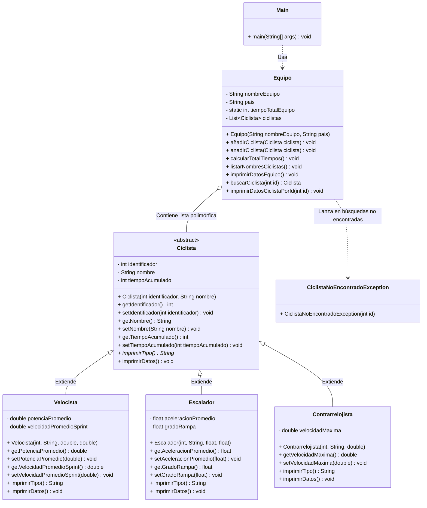

# 🚴‍♂️ Actividad-PG: Sistema de Gestión de Equipo de Ciclismo

Proyecto universitario desarrollado en **Java** aplicando los principios fundamentales de la **Programación Orientada a Objetos (POO)**: herencia, polimorfismo, encapsulamiento, abstracción y manejo de excepciones personalizadas, junto con una suite completa de **pruebas unitarias**.

---

## 👥 Integrantes del Equipo de Trabajo

A continuación se relacionan los integrantes del equipo con sus respectivos roles y componentes desarrollados a lo largo del historial del proyecto:

| Integrante | Correo / GitHub | Rama Asignada | Rol y Responsabilidad en el Proyecto |
| :--- | :--- | :--- | :--- |
| **Johhan González** | `johhangonzalez4@gmail.com` | `main` / `feature/clase-ciclista` | Inicialización del repositorio base. Definición e implementación de la clase abstracta fundamental `Ciclista` (atributos base, getters/setters, método abstracto `imprimirTipo()` y método `imprimirDatos()`). |
| **Juan David González** | `gonzalezzjuandavid@gmail.com` | `juan-david` | Diseño e implementación de las clases especializadas `Velocista` (potencia promedio y velocidad sprint) y `Escalador` (aceleración en subida y grado de rampa), aplicando herencia y sobrescritura de métodos. |
| **Jefferson Paredes** | `jparedese@estudiante.uniajc.edu.co` | `tu-Jefferson` | Implementación de la clase especializada `Contrarrelojista` (velocidad máxima) y de la clase contenedora `Equipo` (gestión de la lista de ciclistas, cálculo del tiempo total acumulado y listado de integrantes). |
| **Deibit Urbano** | `deibiturbanoo@gmail.com` | `deibit` | Integrante 4: Creación de la clase de excepción personalizada `CiclistaNoEncontradoException` y desarrollo de la clase interactiva `Main` con menú por consola, captura mediante `Scanner` y búsqueda por identificador. |
| **Santiago Palma** | `palmasanti88@gmail.com` | `Santiago-Palma` | Integración general, revisión de Pull Requests (#1 y #2), resolución de conflictos entre ramas y ajustes de formato en la visualización de datos en `Equipo.java`. |

---

## 🏛️ Arquitectura del Software

### Diagrama de Clases



### Conceptos de POO Aplicados

1. **Abstracción**: `Ciclista` define el molde genérico con atributos y comportamientos comunes que no pueden instanciarse directamente.
2. **Herencia**: `Velocista`, `Escalador` y `Contrarrelojista` reutilizan la lógica común de `Ciclista` mediante `extends` y la llamada al constructor padre `super(...)`.
3. **Polimorfismo**: La lista `List<Ciclista>` en `Equipo` puede albergar indistintamente cualquier subclase de `Ciclista`. Al invocar `imprimirTipo()` o `imprimirDatos()`, cada objeto responde según su tipo en tiempo de ejecución.
4. **Encapsulamiento**: Todos los atributos están definidos con visibilidad privada (`private`) y se accede a ellos mediante métodos públicos de acceso y mutación (`getters`/`setters`).
5. **Manejo de Excepciones**: Implementación de `CiclistaNoEncontradoException` (subclase de `Exception`) para reportar de forma segura cuando un identificador de ciclista no existe dentro del equipo.

---

## 📁 Estructura del Repositorio

```text
Actividad-PG/
├── Ciclista.java                    # Clase abstracta base
├── Velocista.java                   # Subclase especializada de ciclista
├── Escalador.java                   # Subclase especializada de ciclista
├── Contrarrelojista.java            # Subclase especializada de ciclista
├── Equipo.java                      # Clase contenedora del equipo y sus ciclistas
├── CiclistaNoEncontradoException.java # Excepción personalizada para búsquedas
├── Main.java                        # Punto de entrada de la aplicación con menú interactivo
├── PruebasUnitarias.java            # Suite de pruebas unitarias autónoma (zero-dependency)
├── README.md                        # Documentación oficial del proyecto
└── test/                            # Pruebas unitarias en estándar JUnit 5
    ├── CiclistaTest.java            # Pruebas de clases de ciclistas
    └── EquipoTest.java              # Pruebas de equipo y lógica de negocio
```

---

## 🧪 Casos de Pruebas Unitarias

El proyecto incluye dos modalidades de pruebas unitarias:
1. **Suite Autónoma (`PruebasUnitarias.java`)**: Ejecutable en cualquier entorno sin dependencias ni librerías externas.
2. **Suite JUnit 5 (`test/`)**: Pruebas listas para integrarse en IDEs como NetBeans, IntelliJ IDEA o Eclipse.

### Matriz de Casos de Prueba Implementados

| ID | Clase Evaluada | Escenario de Prueba | Resultado Esperado |
| :--- | :--- | :--- | :--- |
| **CP01** | `Ciclista` | Creación de ciclista y verificación de valores base (ID, nombre, tiempo inicial en 0). | Atributos coinciden con los suministrados en el constructor; tiempo inicial es 0. |
| **CP02** | `Ciclista` | Modificación de valores con setters (`setIdentificador`, `setNombre`, `setTiempoAcumulado`). | Los getters retornan los nuevos valores actualizados. |
| **CP03** | `Velocista` | Instanciación con potencia promedio y velocidad sprint. | Retorna la potencia y velocidad esperadas; setters actualizan correctamente. |
| **CP04** | `Velocista` | Invocación de `imprimirTipo()`. | Retorna exactamente `"Es un Velocista"`. |
| **CP05** | `Escalador` | Instanciación con aceleración promedio y grado de rampa. | Retorna aceleración y grado de rampa esperados; setters actualizan correctamente. |
| **CP06** | `Escalador` | Invocación de `imprimirTipo()`. | Retorna exactamente `"Es un Escalador"`. |
| **CP07** | `Contrarrelojista` | Instanciación con velocidad máxima. | Retorna velocidad máxima esperada; setter actualiza correctamente. |
| **CP08** | `Contrarrelojista` | Invocación de `imprimirTipo()`. | Retorna exactamente `"Es un Contrarrelojista"`. |
| **CP09** | `Equipo` | Inicialización de equipo nuevo. | Asigna nombre, país y la lista de ciclistas inicia vacía (`size() == 0`). |
| **CP10** | `Equipo` | Inserción de ciclistas con `añadirCiclista(...)`. | El tamaño de la lista se incrementa adecuadamente con cada ciclista agregado. |
| **CP11** | `Equipo` | Polimorfismo en la colección de ciclistas. | La lista contiene instancias de Velocista, Escalador y Contrarrelojista respondiendo a sus métodos específicos. |
| **CP12** | `Equipo` | Cálculo de `tiempoTotalEquipo`. | El tiempo total coincide con la suma matemática exacta de los tiempos de todos los ciclistas. |
| **CP13** | `Equipo` | Recálculo de tiempo al alterar el tiempo de un ciclista. | Al invocar `calcularTotalTiempos()`, el tiempo acumulado del equipo refleja el nuevo valor. |
| **CP14** | `Equipo` | Búsqueda por ID existente (`buscarCiclista(id)`). | Retorna la referencia al ciclista correspondiente sin lanzar excepciones. |
| **CP15** | `Equipo` | Búsqueda por ID inexistente (`buscarCiclista(999)`). | Lanza controladamente `CiclistaNoEncontradoException`. |
| **CP16** | `Equipo` | Actualización masiva con `setCiclistas(...)`. | Sustituye la lista y recalcula de inmediato el tiempo total acumulado. |
| **CP17** | `Equipo` | Modificación de nombre y país con setters. | Getters retornan los nuevos datos asignados al equipo. |
| **CP18** | `CiclistaNoEncontradoException` | Verificación del mensaje descriptivo de error. | El mensaje de la excepción contiene el identificador buscado. |

---

## 🚀 Instalación y Ejecución

### Prerrequisitos
- Tener instalado el **Java Development Kit (JDK)** versión 8 o superior (probado en JDK 17, 21 y 25).
- Git instalado en su sistema.

### 1. Clonar el Repositorio
```bash
git clone https://github.com/JohhanG/Actividad-PG.git
cd Actividad-PG
```

### 2. Compilar el Proyecto
Para compilar todas las clases del proyecto en la consola:
```bash
javac -encoding UTF-8 *.java
```

### 3. Ejecutar la Aplicación Principal
Para iniciar la aplicación interactiva de consola:
```bash
java Main
```

### 4. Ejecutar las Pruebas Unitarias
Para ejecutar la suite de pruebas unitarias autónoma:
```bash
java PruebasUnitarias
```

Salida esperada de las pruebas:
```text
===============================================================
       EJECUCIÓN DE PRUEBAS UNITARIAS - ACTIVIDAD-PG           
===============================================================

  [PASS] Ciclista - Atributos base y constructor
  [PASS] Ciclista - Modificación de atributos con setters
  [PASS] Velocista - Constructor y atributos específicos
  [PASS] Velocista - Método imprimirTipo()
  [PASS] Escalador - Constructor y atributos específicos
  [PASS] Escalador - Método imprimirTipo()
  [PASS] Contrarrelojista - Constructor y velocidad máxima
  [PASS] Contrarrelojista - Método imprimirTipo()
  [PASS] Equipo - Inicialización y atributos base
  [PASS] Equipo - Añadir ciclistas y tamaño de lista
  [PASS] Equipo - Polimorfismo con distintas especialidades
  [PASS] Equipo - Cálculo automático de tiempo total acumulado
  [PASS] Equipo - Recálculo de tiempo al modificar ciclistas
  [PASS] Equipo - Búsqueda exitosa de ciclista por ID
  [PASS] Equipo - Búsqueda fallida lanza CiclistaNoEncontradoException
  [PASS] Equipo - Actualización mediante setCiclistas() recalcula tiempo
  [PASS] Equipo - Modificación de nombre y país
  [PASS] Excepción - Mensaje descriptivo con ID correcto

===============================================================
                 RESUMEN DE PRUEBAS UNITARIAS                  
===============================================================
Total ejecutadas : 18
Exitosas [PASS]  : 18
Fallidas [FAIL]  : 0

>>> RESULTADO: TODAS LAS PRUEBAS PASARON SATISFACTORIAMENTE <<<
```

---

## 💻 Manual de Uso de la Aplicación

Al ejecutar `Main`, se inicializa el equipo **Team Colombia** con tres ciclistas precargados:
- **Fernando Gaviria** (Velocista, ID `101`, 185 min acumulados)
- **Nairo Quintana** (Escalador, ID `102`, 170 min acumulados)
- **Rigoberto Urán** (Contrarrelojista, ID `103`, 178 min acumulados)

### Opciones del Menú:
- **Opción 1: Ver datos del equipo**: Muestra el nombre del equipo, país y el tiempo acumulado total (533 minutos).
- **Opción 2: Listar nombres de ciclistas**: Imprime la lista completa de integrantes con su ID y nombre.
- **Opción 3: Buscar ciclista por identificador**: Solicita un número entero e imprime la ficha técnica detallada del ciclista con los datos propios de su especialidad (o notifica si no existe).
- **Opción 0: Salir**: Termina la ejecución del programa de forma limpia.
